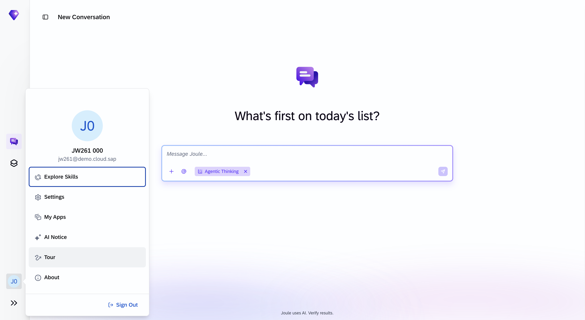
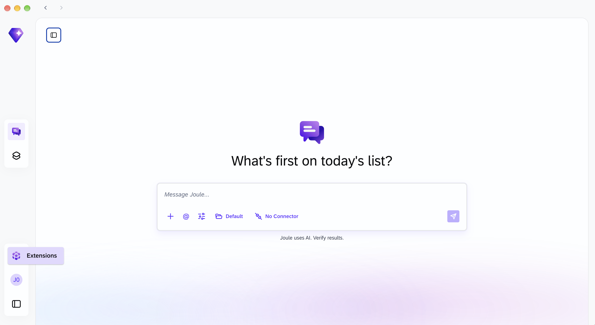
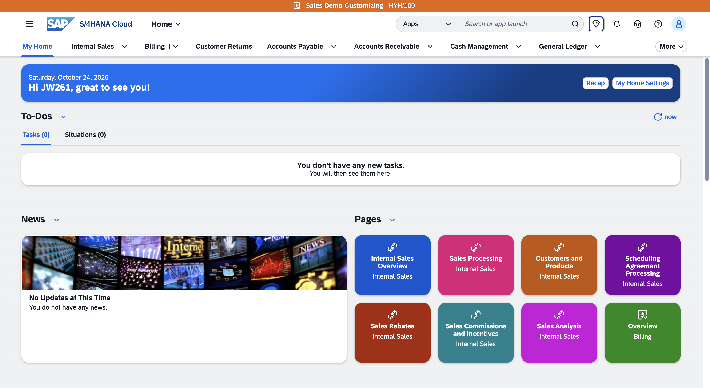

# Exercise 0 - Getting Started

**Learning Objectives**
After completing this exercise, you will be able to:
- Describe the three Joule Work surfaces and when to use each one.
- Log in to all three surfaces using your session credentials.
- Navigate the main areas of the Joule Work interface.
- Verify that your environment is working with a first test prompt.

**Estimated time:** 15 minutes

---

## 1. The Three Joule Work Surfaces

Joule Work is available across three surfaces. Each serves a different context. You will use all three during this session.

### 1.1 Joule embedded in SAP S/4HANA

A slide-out panel inside the Fiori shell bar, identified by the **diamond icon** in the top-right corner.

**Best for:**
- In-context queries without leaving S/4HANA
- Navigational, transactional, and analytical interactions scoped to one system

**How to access:** Click the **diamond icon** icon in the top-right of the Fiori shell bar.

When you need more than the panel offers like Spaces, cross-system context, or local files you can jump directly to the full Joule Work web experience. Look for the **Open in Joule Work** link or the expand icon inside the panel. Your SAP session and credentials carry over automatically; no second login is needed.

> **Note:** The embedded panel is scoped to a single S/4HANA system. It does not support Spaces, cross-system context, or local file access.

---

### 1.2 Joule Work Web

A browser-based experience. No installation required, works on any device.

**Best for:**
- Live queries against connected SAP systems
- Working with Assistants and Skills
- Building and managing Spaces (persistent dashboards)
- Receiving briefings and summaries across systems

**How to access:** Open the URL provided by your instructor in a browser.

**Take the product tour**
When you open Joule Work for the first time, a guided tour starts automatically. Click "Show Me Conversations" to start it.

If the tour did not start automatically, you can trigger it manually:

Click the "J0 / JW261 001" avatar at the bottom of the left sidebar.
Select "Tour" from the menu.




> **Agentic thinking** is a Joule Work web capability. It appears as a pill in the conversation input window and, when active, lets Joule plan, decompose, and execute complex multi-step tasks autonomously invoking Skills, Agents, and connected systems in sequence until the goal is met. ([SAP Help: Joule Work](https://help.sap.com/doc/525677ed302148a4b7cc9988321055fb/CLOUD/en-US/dc1706e63f4d443f9da2aeae83a2277e.pdf))

---

### 1.3 Joule Work desktop application

A native application for macOS and Windows that adds capabilities not available in the browser.

**Best for:**
- Attaching local files (files never leave your machine and processing stays local)
- Working with local workspace folders
- Running sandboxed code execution
- Building Skills with the built-in Skill Creator
- Add connectors and M365 connectivity (not available in the demo set-up)

**How to access:** The desktop client is pre-installed on your laptop. Uses the same credentials as Joule Work web.




---

## 2. Log In

### 2.1 Joule Embedded in SAP S/4HANA

1. Open your browser.
2. Navigate to the **S/4HANA system**: https://my441372.s4hana.cloud.sap/ui
3. Enter the **username** and **password** from your credential card (provided by your instructor).
4. For direct full-screen access you can open a seperate tab and follow 2.2 or got to "Open Joule Work"




### 2.2 Joule Work web

1. Open a new browser tab.
2. Navigate to the **Joule Work Web URL** printed on your credential card.
3. Enter the **username** and **password** from your credential card (same credentials).

### 2.3 Joule Work desktop application

1. Open the Joule Work application on your laptop.
2. Enter the **username** and **password** from your credential card (same credentials).

---

## 2.5 Activate Required Skills

Before starting the exercises, ensure the S/4HANA skills are activated.

1. In Joule Work Web, click your **user initials** in the bottom-left corner
2. Select **Explore Skills** or **Extensions**
3. Search for and activate the following skills:
   - **S/4HANA Public Cloud** - Toggle **ON**
   - **S/4HANA Private Cloud** - Toggle **ON** (if available)

> **Note:** These skills enable Joule to query data from your S/4HANA system. Without them, prompts in Exercise 1 and beyond may not return results.

4. Return to your conversation

---

## 3. Orient Yourself: Main Navigation Areas

Take a moment to locate each area in the Joule Work Web interface before you start working.

1. Find the **Conversations** section in the left sidebar.
   - This is where all persistent conversation threads live.
   - Use the **New Conversation** button (pencil or `+` icon) to start a fresh thread.
   - Conversations sync across your Joule Work Web sessions. Joule Work desktop starts from scratch with no prior conversation history.

2. Find the **Spaces** section in the left sidebar.
   - Spaces are persistent dashboards made of data cards.
   - Each card can be refreshed independently using the ↻ icon on the card.
   - You will build and populate Spaces in Exercise 4.

3. Find the **Develop** section (sometimes shown as a code/wrench icon).
   - This is the entry point to **Joule Studio** where you create and manage Agents and Connectors.

4. Find the **Extensions** section (or **Marketplace** / **Skills** panel, depending on your version).
   - This is where you discover and activate pre-built Skills, Assistants, and MCP connectors.
   - You will activate Skills here in Exercise 2.

5. Find **Settings** (gear icon, usually bottom-left or top-right).
   - Settings include: language, default model, connected accounts, and on desktop workspace folder configuration.

> **Note:** Navigation labels may vary slightly between versions. If you cannot find a section, hover over the icons in the sidebar to reveal tooltips.

---

## 4. Verify Your Environment

Let's confirm that your environment is set up correctly with a simple first prompt.

1. Click **New Conversation** to open a fresh thread.

2. 👉 Copy and paste the following prompt:

```
What is Joule Work and what can I do with it here?
```

3. Press **Enter** (or click the send icon) and wait for the response.

**Result:** Joule Work responds with an overview of its capabilities: conversations, connected SAP systems, Spaces, Skills, and Assistants. If you receive a response, your environment is working correctly.

> **Tip:** If you do not receive a response within 30 seconds, refresh the browser tab and try again. If the issue persists, let your instructor know.

---

## Summary

In this exercise you:
- Learned the three Joule Work surfaces (embedded, web, desktop) and what each is best suited for.
- Logged in to all three surfaces using your session credentials.
- Located the main navigation areas: Conversations, Spaces, Develop, Extensions, and Settings.
- Sent your first prompt to confirm the environment is working.

[Continue to Exercise 1 →](../ex1%20-%20From%20SAP%20S4HANA%20to%20Joule%20Work/README.md)
