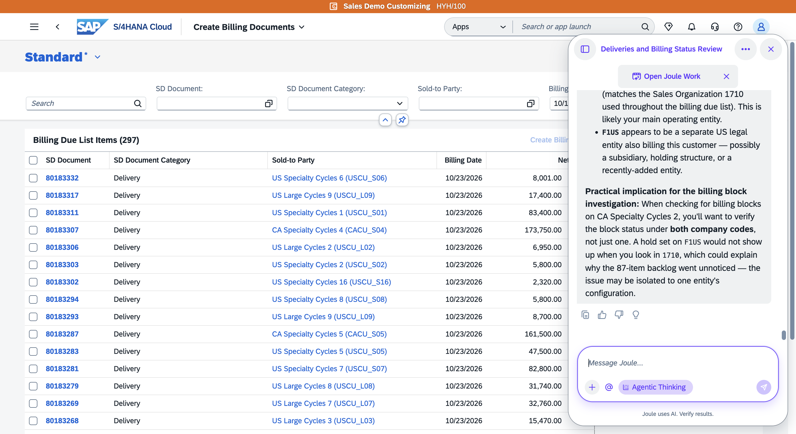
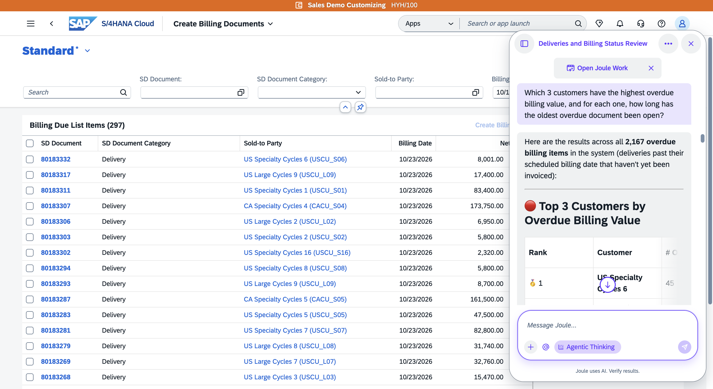
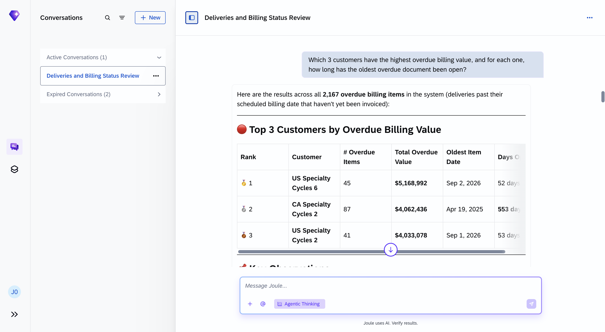

# Exercise 1 - From SAP S/4HANA to Joule Work

**Learning Objectives**
After completing this exercise, you will be able to:
- Use the Joule embedded panel in SAP S/4HANA to run transactional and analytical queries.
- Recognise the boundaries of the embedded experience and explain why those boundaries exist.
- Open Joule Work Web and orient yourself for a cross-system, multi-capability workflow.
- Use Joule Work Web to begin a structured thinking conversation about a business scenario.

**Estimated time:** 25 minutes

---

## 1. Open the Joule Panel in SAP S/4HANA (if not done if previous exercise)

1. In your browser, open the **SAP S/4HANA Fiori Launchpad** using the URL on your credential card.
2. Log in with the S/4HANA credentials provided by your instructor.
3. Locate the **diamond icon** in the **top-right corner** of the Fiori shell bar.
4. Click the **diamond icon** icon to open the Joule slide-out panel.

**Result:** The Joule panel opens on the right side of the screen without leaving the Fiori Launchpad. You can still navigate the Launchpad behind it.

---

## 2. Run a Cross-App Transactional Query

You want to know which customers have deliveries sitting in the billing due list right now and whether any of those same customers also have billing documents from last month that were never posted.

1. Click inside the Joule input field at the bottom of the panel.

2. 👉 Copy and paste the following prompt:

```
What's sitting on my billing due list right now? Which customers, how much, and how long has it been there? And is the backlog still growing this week?
```

3. Press **Enter** and wait for the response.

 **Result:** Joule returns a combined view of customers with pending due list items this week, with any overlap flagged where the same customer also has unposted documents from the prior month. One answer from two apps' worth of data.

 




4. To see the same data in S/4HANA you would need to check two apps:
   - **Create Billing Documents**: search icon in the Fiori shell bar → type `Create Billing Documents` → filter by this week's billing date to see the due list items.
   - **Manage Billing Documents**: search icon → type `Manage Billing Documents` → filter by last month's billing date and status *Not Posted* to find the unposted documents.

---

## 3. Run an Analytical Query

You want to know which customers are driving the most overdue billing exposure and how long each has been sitting.

1. In the same Joule panel, click the input field again.

2. 👉 Copy and paste the following prompt:

```
Which 3 customers have the highest overdue billing value, and for each one, how long has the oldest overdue document been open?
```

3. Press **Enter** and wait for the response.

**Result:** Joule returns a ranked list of the top 3 customers by overdue value, with the age of each customer's oldest open document — filtering, grouping, summing, and aging all in one step.





4. To find the same data in S/4HANA: open **Manage Billing Documents**, filter by billing date before today and posting status *Open*, group by sold-to party, and sort by total amount descending.

---

## 4. Move to Joule Work Web with Your Context

The embedded panel gives you fast, in-context access to S/4HANA data — including Skills and Assistants. When you need to go further with Spaces, cross-system queries, or local files, Joule Work Web is the next step.

**The key: your conversation carries over.** The session you just had in the embedded panel is already visible in Joule Work Web. You pick up exactly where you left off — Joule already knows which customers have aged items and what the ranking looks like.

What the embedded panel cannot do that Web adds:
- **Spaces** — persist results as live dashboard cards you return to daily
- **Cross-system context** — correlate S/4HANA data with Ariba, SAP Analytics Cloud, or other systems
- **Local file access** — attach spreadsheets, forecasts, or PDFs from your laptop

---

## 5. Open Joule Work Web

1. Inside the embedded Joule panel, look for the **Open in Joule Work** link or the expand icon at the top of the panel — this jumps directly to Joule Work Web with your session intact.

   Alternatively, open a **new browser tab** and navigate to the **Joule Work Web URL** on your credential card. Sign in with the same SSO credentials.

2. In the **left sidebar**, find the conversation that just came from the embedded session — it will appear at the top of your Conversations list.

3. Click it to open it.

**Result:** The conversation from your S/4HANA session is right there — the billing aging query and the top-5 customer ranking are already in the thread. You are not starting from scratch; you are continuing.





---

## 6. Continue the Conversation in Joule Work Web

Now build on what Joule already surfaced. You do not need to re-explain the situation — Joule has the context.

1. In the same conversation thread, click the input field.

2. 👉 Copy and paste the following prompt:

```
Based on what we just found, which of these customers should I prioritise for follow-up before the Q4 close, and what would you recommend as the next action for each?
```

3. Press **Enter** and read the full response before moving on.

**Result:** Joule builds on the billing data it already surfaced — the aged items, the customer ranking, the document types — and returns a prioritised action plan grounded in the actual numbers from your S/4HANA system.

> **Note:** This is still general Joule reasoning over the conversation context. In **Exercise 2** you will activate the Financial Closing Assistant, which connects directly to your S/4HANA system and can ground every answer in live data rather than the conversation history alone.

---

## Summary

In this exercise you:
- Opened the Joule embedded panel in SAP S/4HANA and ran two complex queries that would each require multiple manual steps in the Fiori apps.
- Recognised what the embedded panel cannot do and transitioned to Joule Work Web — carrying the conversation context with you.
- Continued the same conversation thread in Web, building directly on the billing data Joule had already surfaced.

[Continue to Exercise 2 →](../ex2%20-%20From%20Billing%20Analysis%20to%20Risk%20Assessment%20Document/README.md)
