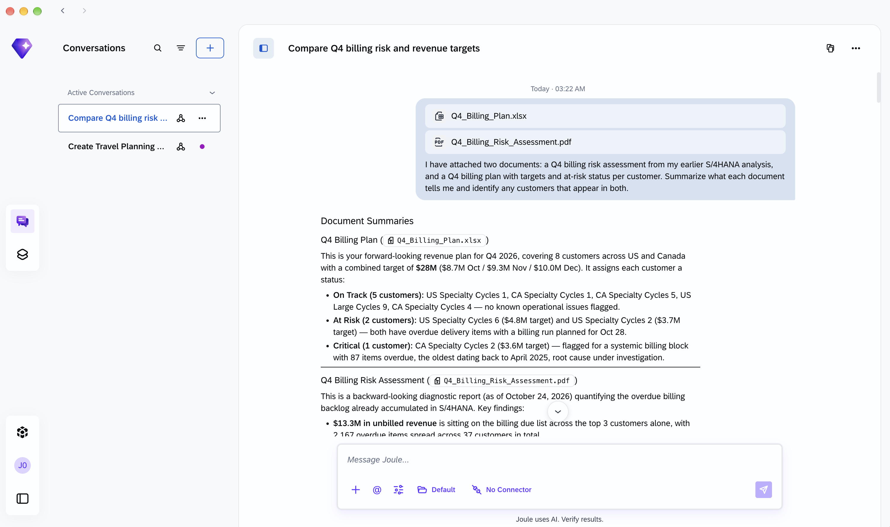
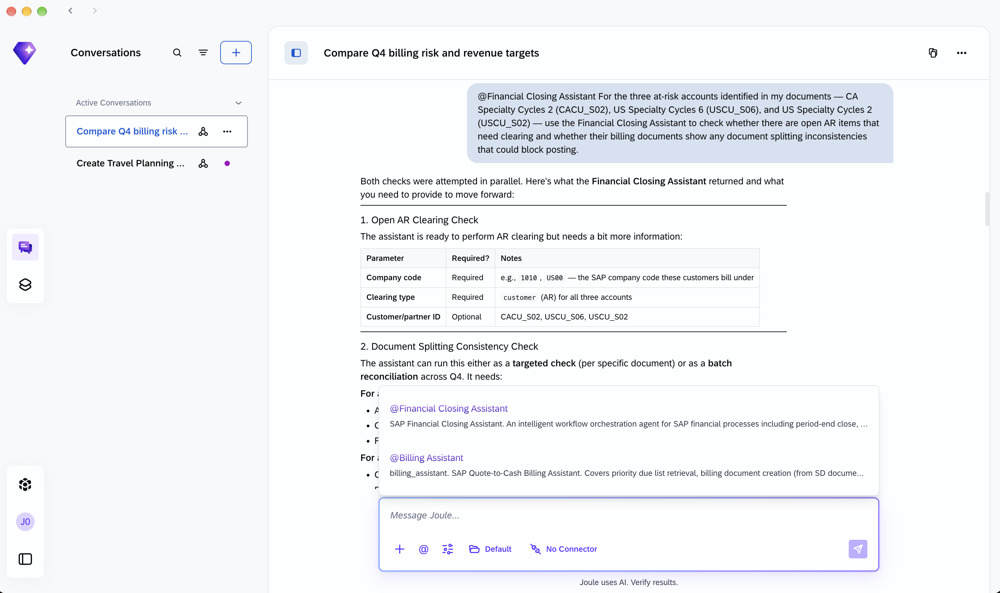
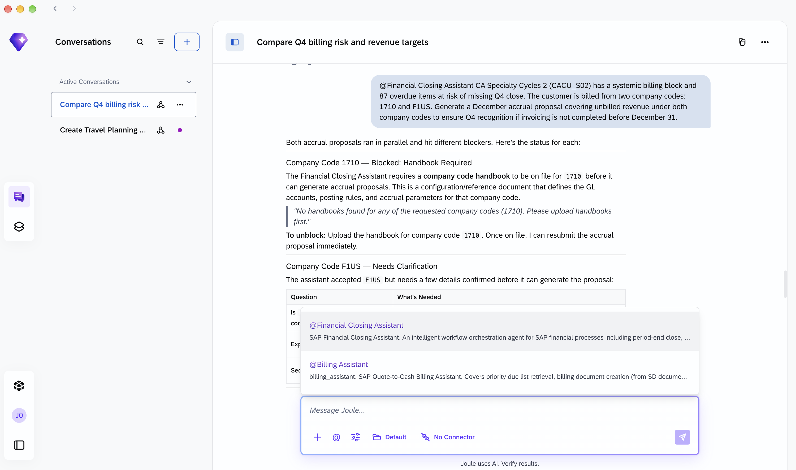
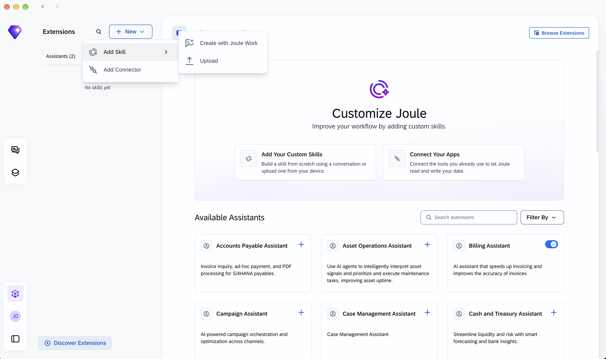

# Exercise 3 - Desktop: Local Files and the Financial Closing Assistant

**Learning Objectives**
After completing this exercise, you will be able to:
- Attach multiple local files to a single desktop conversation.
- Activate the Financial Closing Assistant and use it for transactional close actions grounded in file context.
- Use the Assistant to clear open items and generate accrual proposals for at-risk accounts.
- Build a custom Skill that automates this three-source close workflow.

**Estimated time:** 30 minutes

> **Note:** If the Financial Closing Assistant is not available during your session, use the backup data file: [`Financial_Closing_Assistant_Output.md`](../../assets/Financial_Closing_Assistant_Output.md) to understand the expected outputs and proceed to Exercise 4.

---

## 1. Open Joule Work desktop application

1. Launch Joule Work desktop from **Applications** (macOS) or **Start Menu** (Windows).
2. Sign in with your SSO credentials.
3. Desktop starts from scratch. There is no conversation history from Exercises 1 and 2 here. The context you carry forward comes from the two files you prepared: the risk assessment saved from Web and the billing plan from the session repository.

---

## 2. Prepare Your Two Files

**File 1 — Risk assessment from Exercise 2:**
- Use the `Q4_Billing_Risk_Assessment.pdf` you saved at the end of Exercise 2.
- If you do not have it, return to Exercise 2 and complete step 5 before continuing.

**File 2 — Billing plan from the session repository:**
1. Download [`assets/Q4_Billing_Plan.xlsx`](../../assets/Q4_Billing_Plan.xlsx).
2. The file contains 8 SAP demo customers — US Specialty Cycles 6, CA Specialty Cycles 2, US Specialty Cycles 2 (the three high-risk accounts from the PDF), and five on-track accounts. Status levels are On Track, At Risk, and Critical.

### Alternative Files for Accruals Flow

If you want to explore the accruals workflow with local files in Desktop, you can use these alternative files:

**File 1 — Policy Reference:**
- `assets/00HO_JE-Policy_v0.xlsx` - Journal entry policy with GL accounts, cost centers, and WBS elements

**File 2 — Sample Journal Entry Data:**
- `assets/00HO_JE_v1.xlsx` - Sample journal entries for company code 00HO showing posting patterns

You can attach these files and ask questions like:
```
Cross-reference the sample journal entries in 00HO_JE_v1.xlsx against the policy rules in 00HO_JE-Policy_v0.xlsx. Do the GL accounts and cost centers match the defined policy?
```

---

## 3. Start a New Conversation and Attach Both Files

1. Click **New Conversation**.
2. Click the `+ icon and attach both files:
   - `Q4_Billing_Risk_Assessment.pdf`
   - `Q4_Billing_Plan.xlsx`

3. 👉 Copy and paste the following prompt:

```
I have attached two documents: a Q4 billing risk assessment from my S/4HANA analysis and a Q4 billing plan with status per customer. Summarize what each document tells me and identify which customers appear in both as at-risk or critical.
```

**Result:** Joule reads both files and identifies the overlap — CA Specialty Cycles 2 (Critical), US Specialty Cycles 6 (At Risk), and US Specialty Cycles 2 (At Risk) appear in both documents with consistent risk signals.



---

## 4. Activate the Financial Closing Assistant

Before using the Financial Closing Assistant, you need to enable it in Desktop.

1. In the left sidebar, click on the **cube icon** labeled **"Extensions"** (located above your avatar)
2. Navigate to the **"Assistants"** panel
3. Find **Financial Closing Assistant** in the list
4. Toggle it **ON**

**Result:** The Financial Closing Assistant is now active and can be invoked with `@Financial Closing Assistant` in your prompts.

> **Note:** The Financial Closing Assistant handles transactional close actions: clearing open items, creating journal entry proposals, and generating accrual proposals. It does not surface period-end close task lists or billing block status — those are queried directly in S/4HANA via the Manage Your Closing Activities app and the Billing Due List (F0798).

---

## 5. Clear Open Items for the At-Risk Accounts

With both files attached and the Financial Closing Assistant active, Joule can now take closing actions grounded in the accounts identified in your documents.

1. 👉 Copy and paste the following prompt:

```
@Financial Closing Assistant CA Specialty Cycles 2 (CACU_S02) has a systemic billing block and 87 overdue items at risk of missing Q4 fiscal year 2026 close. The customer is billed from two company codes: 1710 and F1US. Generate a December accrual proposal covering unbilled revenue under both company codes to ensure Q4 FY2026 recognition if invoicing is not completed before December 31.
```

**Result:** The Financial Closing Assistant checks open item status for all three accounts and returns a summary of any issues that need resolution before close.



---

## 6. Scope the December Accrual Requirements

CA Specialty Cycles 2 has 87 items overdue, oldest from April 2025. If the billing block is not resolved before December 31 the revenue slips to FY27. Before an accrual can be posted, the Financial Closing Assistant needs to know what it is working with.

This customer is billed from two company codes simultaneously: **1710** (primary US operating entity, matching Sales Organization 1710) and **F1US** (a separate US legal entity). Both have documents as recent as October 23, 2026. A block set on F1US would not appear when checking 1710, which may explain why the 87-item backlog went unnoticed.

1. 👉 Copy and paste the following prompt:

```
CA Specialty Cycles 2 (CACU_S02) has a systemic billing block and 87 overdue items at risk of missing Q4 close. The customer is billed from two company codes: 1710 and F1US. What do you need from me to generate a December accrual proposal covering unbilled revenue under both company codes?
```

**Result:** The Financial Closing Assistant identifies the prerequisites for each entity. For **1710** it requires a company code handbook (GL accounts, posting rules, and accrual parameters) to be on file before it can post. For **F1US** it asks for confirmation of the revenue split across the two codes. This is the expected behaviour in a system where handbooks are not yet uploaded for a company code.

> **Note: If the Assistant Asks for a Handbook**
> 
> The Financial Closing Assistant may respond that it needs an **accruals policy handbook** to be uploaded before it can generate accrual proposals. This is expected if no handbook has been uploaded yet for company code 1710 or F1US.
> 
> **What is an accruals policy handbook?**
> An accruals policy handbook is a document (PDF or Excel) that defines the posting rules for accruals: GL accounts, cost centers, calculation methods, document types, and reversal behavior for each accrual category.
> 
> **How to upload:**
> If the assistant requests a handbook, use this prompt:
> 
> ```
> @Financial Closing Assistant Upload accruals policy handbook for company code 1710
> ```
> 
> Then attach the policy file when prompted. For this exercise, you can use the sample file: `assets/00HO_JE-Policy_v0.xlsx` (adapt company code references as needed).
> 
> **For detailed handbook requirements and structure**, see: [AS260 Accruals Exercise - Section 4: Policy Handbook](https://github.com/SAP-samples/teched2026-AS260/tree/main/exercises/Accruals#4-preparation--policy-handbook)

> **Note:** In a fully configured production system with handbooks on file, the same prompt generates the accrual proposals directly. What you see here is the Assistant correctly surfacing the missing configuration, a finding that is itself actionable: the billing team now knows the handbook for 1710 is missing and the revenue split for F1US needs to be confirmed before any accrual can be posted.



---

## 7. Build a Skill for This Workflow

The three-step flow you just ran: cross-reference files, clear open items, generate accrual safety net — is repeatable every week until close.

1. 👉 Copy and paste the following prompt:

```
Create a skill for me
```

---

## 8. Define the Skill

1. When Joule asks for a **name**, type:

```
Q4 Close Readiness Check
```

2. When Joule asks for a **description**, 👉 copy and paste the following:

```
When triggered, read Q4_Billing_Risk_Assessment.pdf and Q4_Billing_Plan.xlsx from the working directory. Identify all customers with At Risk or Critical status across both documents. Use the Financial Closing Assistant to: (1) check open AR items for each flagged customer and (2) generate a December accrual proposal for any customer with a critical billing block where Q4 invoicing is uncertain for CA Specialty Cycles 2 (CACU_S02) include both company codes 1710 and F1US. Output a structured Close Readiness Report with one section per at-risk customer.
```

**Result:** Joule drafts a `SKILL.md` with the workflow defined as named steps referencing both local file inputs and Financial Closing Assistant actions.



---

## 9. Save, Activate, and Test

1. Click **Save & Activate**.
2. 👉 Copy and paste the following prompt:

```
Run Q4 close readiness check.
```

**Result:** The complete workflow runs from a single prompt both files read, at-risk customers identified, open items checked, accrual proposal generated for CA Specialty Cycles 2.

---

## Backup Data for Exercise 4

If the Financial Closing Assistant didn't work or you need reference data for creating your Space in Exercise 4, download this backup file:

📄 **[Q4_Close_Readiness_Backup.pdf](../../assets/Q4_Close_Readiness_Backup.pdf)** - Contains close readiness data you can use as the basis for Space creation.

---

## Summary

In this exercise you:
- Attached a live-generated PDF and a local Excel as context in a single desktop conversation.
- Activated the Financial Closing Assistant and used it for what it does best: clearing open items and generating accrual proposals for revenue at risk of missing Q4 close.
- Built a reusable Skill that automates the weekly close readiness check from two files to a structured report.

[Continue to Exercise 4 →](../ex4%20-%20Spaces%20From%20Weather%20to%20Close%20Readiness/README.md)
