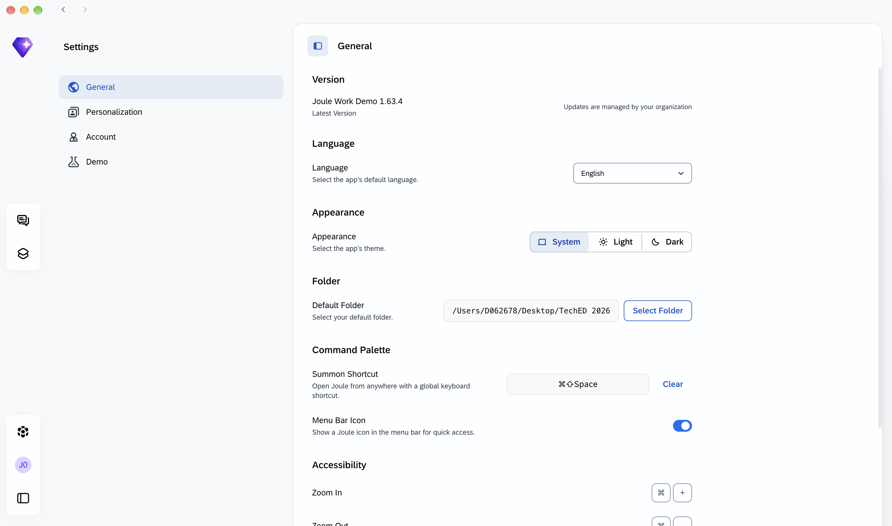
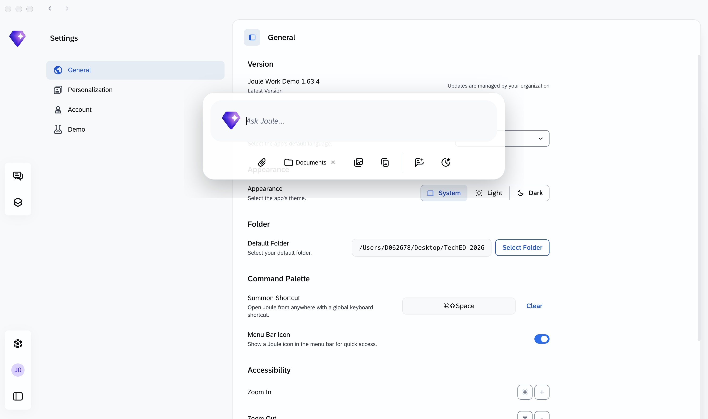

# Exercise 5 - Joule Everywhere: The Command Palette

> 📌 **This exercise is standalone.** All you need is Joule Work desktop application installed and signed in.

**Learning Objectives**
After completing this exercise, you will be able to:
- Enable the summon shortcut to invoke Joule from any application on your machine.
- Learn what the summon feature and command palette can do.

**Estimated time:** 10 minutes

**Surface:** Joule Work desktop application

---

## 1. Enable the Summon Shortcut

The command palette lets you summon Joule with a keyboard shortcut from any app. From your browser, email client, spreadsheet, or PDF reader without switching windows.

1. Open Joule Work desktop application.
2. Go to **Settings** → **General** → **Command Palette**.
3. Click the shortcut field and press your preferred key combination.
   - Choose a combination that does not conflict with your other applications.
4. Click **Save**.

> **Note:** Remember your chosen shortcut - you will use it throughout this exercise as **[your summon shortcut]**.



---

## 2. Summon Joule from Another App

1. Switch to any other application — your browser, email client, or file manager.
2. Press **[your summon shortcut]** that you defined in Settings.

**Result:** The Joule command palette opens as a floating overlay — no window switching, no taskbar navigation.



---

## 3. Ask About the Summon Feature

1. With the command palette open, type the following:

👉 Copy and paste the following prompt:
```
What can I do with the summon feature and command palette?
```

2. Press **Enter** to send.

**Result:** Joule explains the summon feature capabilities: invoking Joule from any application, getting answers without context switching, and using keyboard shortcuts to access Joule Work instantly.

3. Press **Esc** to dismiss the overlay and return to what you were doing.

---

## Summary

In this exercise you:
- Enabled the summon shortcut so Joule is always one keystroke away.
- Learned what you can do with the summon feature and command palette.

The command palette is how the session title becomes literal: **Joule Work, everywhere you work.**

---

## 🎉 Session Complete

Congratulations — you've completed all exercises for session **JW261 | Joule Work, Everywhere You Work**.

| Exercise | Surface | What you did |
|---|---|---|
| 0 | Setup | Oriented yourself to Joule Work surfaces, logged in, explored navigation |
| 1 | S/4HANA + Web | Used embedded Joule in S/4HANA, transitioned to Joule Work Web |
| 2 | Joule Work Web | Activated the Financial Closing Assistant, surfaced close blockers, generated a CFO brief with a Skill |
| 3 | Joule Work Desktop | Billing Assistant + local Excel analysis + custom Skill creation |
| 4 | Joule Work Desktop | Built a live, persistent Space with web search, weather, calendar, and S/4HANA close data |
| 5 | Joule Work Desktop | Enabled the command palette and summon shortcut to use Joule from any app |

**What's next?**
- Explore the [SAP AI Skills Library](https://skills.cloud.sap) to discover pre-built skills and MCP connectors for Joule Work desktop application.
- Session materials and this exercise guide remain available at [https://github.com/SAP-samples/teched2026-JW261](https://github.com/SAP-samples/teched2026-JW261).
